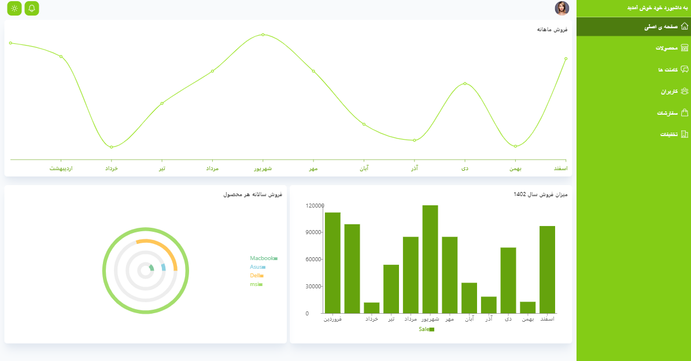
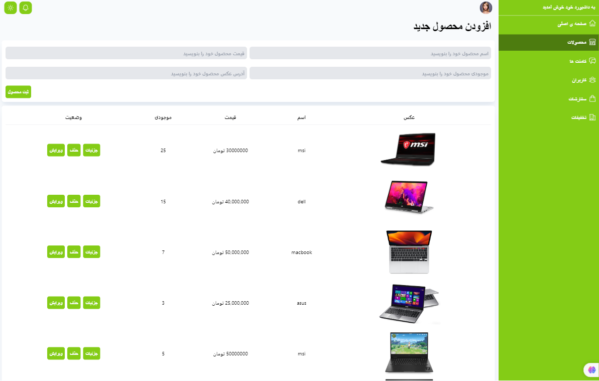
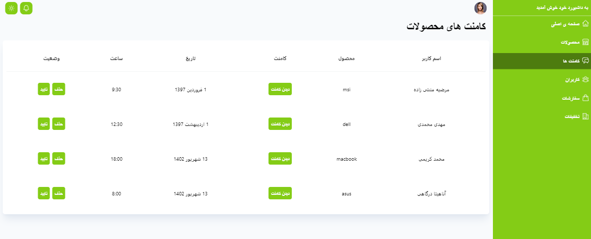
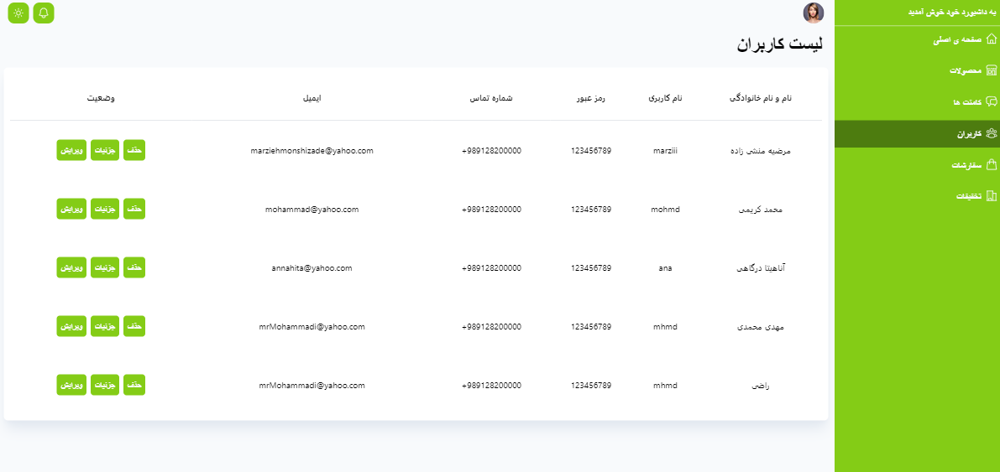
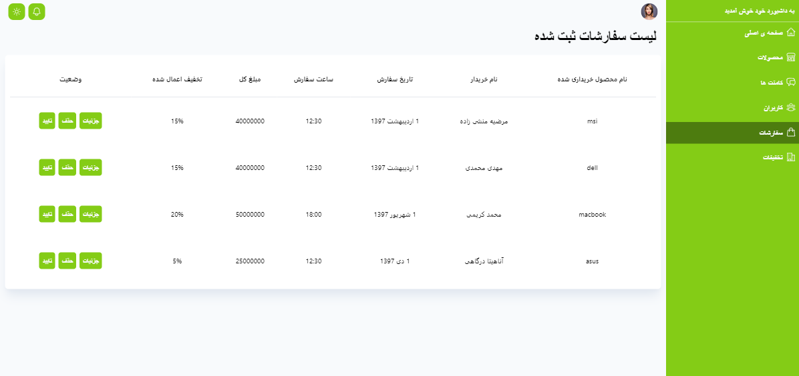
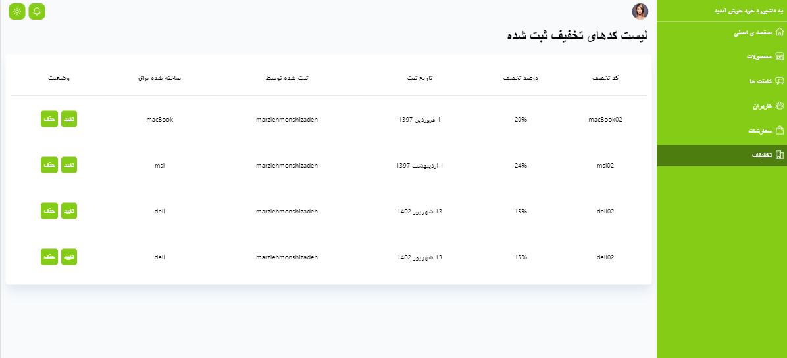
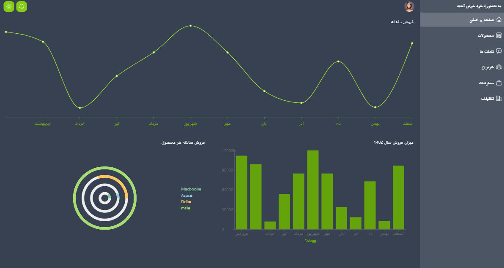
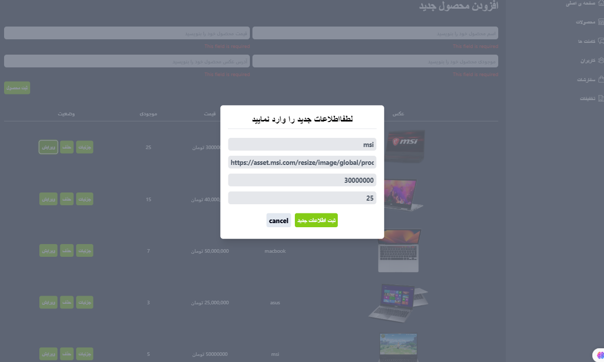

# Rtl-Cms
This is a react js + typescript project bootstrapped with vite.
Please turn on your vpn first, then click on the link below
> Live demo [https://rtl-cms.vercel.app/](https://rtl-cms.vercel.app/)
## Technologies Used

  


## Docker development

Start the frontend and mock API with:

```sh
npm run docker:dev
```

The frontend is available at http://localhost:5173 and the API at http://localhost:3000.
Docker installs dependencies from `package-lock.json` using `npm ci`. The startup
command renews the anonymous `/app/node_modules` volume so dependencies from an
older container cannot hide packages installed in the rebuilt image. This fixes
errors such as `Cannot find module 'tailwindcss-animate'` after adding dependencies.

Stop the services with `npm run docker:dev:down`.

## Theme customization

Edit `src/index.css` for theme changes. Color variables accept complete CSS
colors: names such as `red`, hex values such as `#ef4444`, and functions such as
`rgb(239 68 68)` or `hsl(0 84% 60%)`. Bare HSL channels such as `0 84% 60%`
must be wrapped in `hsl(...)`.

- Change `--primary` in `:root` to recolor buttons, links, focus rings, primary
  charts, and sidebar accents in both light and dark modes. For red, use
  `--primary: red;`. For blue, use `--primary: #2563eb;`.
  Adjust `--primary-foreground` for text contrast.
- Change page, card, text, border, and status colors in `:root` for light mode
  and `.dark` for dark mode. The existing theme switch selects the mode.
- The sidebar starts with its own dark palette. Its `--sidebar-*` variables
  control both desktop and mobile menus, including hover states and borders.
  Sidebar accents inherit `--primary` unless you override `--sidebar-primary`.
- `--chart-1` through `--chart-4` control the radial chart series;
  `--chart-label` controls its labels. `--success`, `--warning`, `--info`, and
  `--destructive` control status colors independently of branding.
- `--font-sans` sets the font stack. `--radius` controls components using
  Tailwind's `rounded-lg`, `rounded-md`, and `rounded-sm`; other radius classes
  keep their own sizes.

To make the sidebar follow the application's light/dark mode, replace its five
palette declarations inside `:root` with:

```css
--sidebar-background: var(--card);
--sidebar-foreground: var(--foreground);
--sidebar-muted-foreground: var(--muted-foreground);
--sidebar-accent: var(--muted);
--sidebar-border: var(--border);
```

For an always-light sidebar, use `white`, `hsl(240 6% 12%)`,
`hsl(240 4% 44%)`, `hsl(240 5% 94%)`, and `hsl(240 6% 90%)`, respectively.
For a different sidebar palette only in dark mode, add overrides for these
variables inside `.dark`.

Vite applies saved CSS changes during development. After this refactor, restart
an already-running dev server once so it reloads the new Tailwind color mappings.
For a deployed site, rebuild and redeploy to apply changes.

## Features

You can :
- add product
- delete product
- edit product
- add user
- delete user
- edit user
- delete comment
- confirmation
- use dark mood
- and etc...

## Screenshots








## Project Status

Project is: _finished

## Contact

Created by Marzieh Monshizadeh :)

